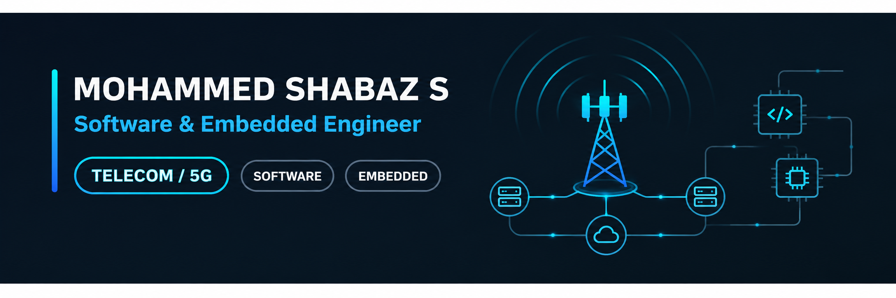
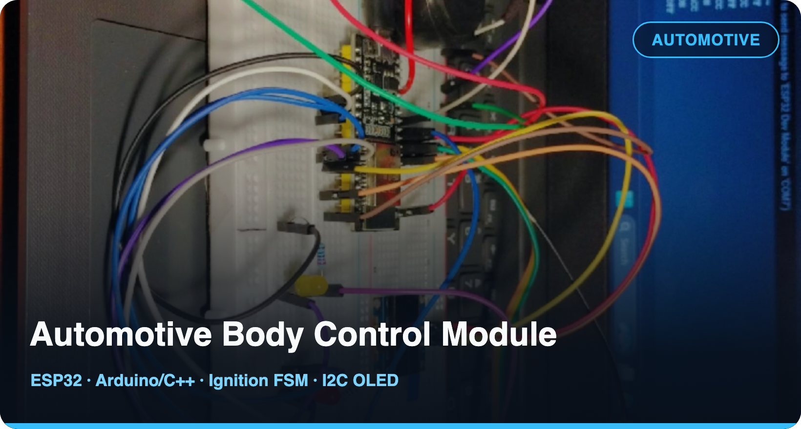
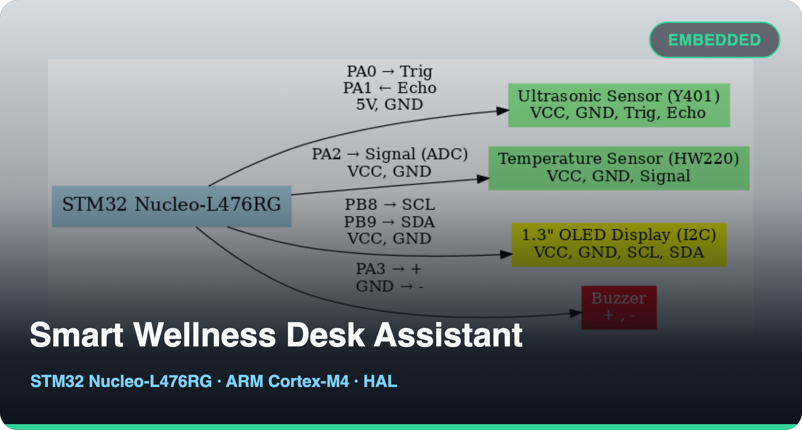
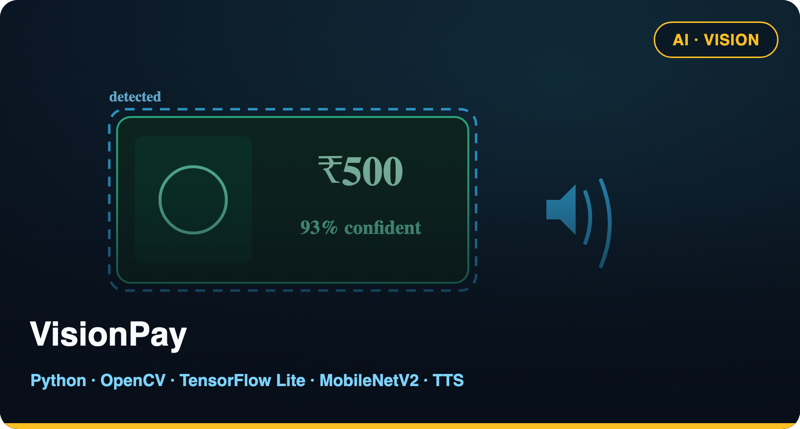

<!-- Profile banner -->

  

  
  
  
  

  
  
  

---

## Professional Snapshot

| Area | Details |
|---|---|
| **Current** | Final-year B.E. Electronics & Communication Engineering, BITM · Student Intern @ Nokia |
| **Primary track** | Telecom / 5G Engineering |
| **Headline** | Software & Embedded Engineer |
| **Supporting** | Software, embedded, automotive and project-level computer vision |
| **Engineering focus** | LTE/5G study, network architecture, mobility, RRM, O-RAN, troubleshooting, software and embedded projects |
| **Education** | BITM · Expected 2027 · CGPA 8.38 |

I’m a final-year ECE student targeting Telecom/5G engineering roles. During my current Nokia internship, I completed study in LTE and 5G network topics. I also bring software and embedded strengths from application work and microcontroller projects. My project-level computer-vision experience is represented through VisionPay.

---

## Focus

<table>
  <tr>
    <td width="33%" valign="top">
      <h3>📡 Telecom &amp; Mobile Networks</h3>
      
Completed LTE and 5G study during the Nokia internship, covering network architecture, interfaces, call flows, mobility, RRM, EN-DC, VoNR, O-RAN and troubleshooting.

    </td>
    <td width="33%" valign="top">
      <h3>💻 Software</h3>
      
Practical software in C, C++, Python and SQL, with Git/GitHub. I care about clean, testable, debuggable code and predictable behaviour.

    </td>
    <td width="33%" valign="top">
      <h3>🚗 Embedded &amp; Automotive</h3>
      
Microcontroller project work on ESP32 and STM32, including finite-state machines, sensor interfacing and non-blocking firmware.

    </td>
  </tr>
</table>

---

## Tech Stack

  

- **Embedded:** Embedded C · Microcontrollers (Intermediate)
- **Programming:** C · C++ · Python · SQL (Intermediate); Java (currently learning)
- **Tools:** Git · GitHub
- **Mobile networks:** Completed LTE and 5G study during the Nokia internship — architecture, EPC, RAN, interfaces, call flows, QoS/RRM, EN-DC, mobility, VoNR, O-RAN and troubleshooting.
- **Testing / automation:** Testing/Debugging (Basic); Robot Framework (currently learning).
- **CS foundations:** DSA · DBMS · Operating Systems · Computer Networks (Basic)
- **Project-only tools:** Android Studio (MITRA) · OpenCV (VisionPay)

Learning next (not current skills): UART/SPI · RTOS/FreeRTOS · CAN-bus networking toward automotive systems.

---

## Featured Projects

<h3><a href="https://github.com/MdShabazS/Automotive-Body-Control-Module-ESP32">Automotive Body Control Module</a> &nbsp;Individual · Embedded / Automotive</h3>

ESP32 firmware modelling a vehicle body-control ECU (photo: the actual breadboard build).

- **OFF/ACC/ON ignition FSM** driving 6+ functions — indicators, synchronized hazard, brake logic, buzzer, OLED dashboard.
- Non-blocking `millis()` loop (zero `delay()`), 30&nbsp;ms brake debounce, 10&nbsp;Hz I2C OLED refresh, clean GPIO abstraction, edge-triggered logging.
- **Stack:** ESP32 · Arduino/C++ · Finite-State Machine · GPIO · I2C OLED &nbsp;—&nbsp; [Repository →](https://github.com/MdShabazS/Automotive-Body-Control-Module-ESP32)

<h3><a href="https://github.com/MdShabazS/Smart-Wellness-Desk-Assistant">Smart Wellness Desk Assistant</a> &nbsp;College team project · Embedded</h3>

STM32 desk-wellness device on ARM Cortex-M4 (image: the project wiring diagram).

- Ultrasonic presence + 12-bit ADC temperature sensing, I2C SSD1306 OLED and timer-driven alerts via a non-blocking finite-state machine.
- **My contribution:** sensor interfacing, wiring, and testing/debugging in STM32CubeIDE within the team.
- **Stack:** STM32 Nucleo-L476RG · ARM Cortex-M4 · STM32 HAL · STM32CubeIDE · Embedded C &nbsp;—&nbsp; [Repository →](https://github.com/MdShabazS/Smart-Wellness-Desk-Assistant)

<h3><a href="https://github.com/MdShabazS/visionpay">VisionPay</a> &nbsp;Individual · AI / Computer Vision</h3>

Offline, real-time Indian-currency detector with spoken output for visually impaired users.

- ~400 images/denomination across 6 classes (₹10–₹500); MobileNetV2 → TensorFlow Lite (~93% reported validation accuracy), running offline on CPU.
- Confidence/margin gating, temporal smoothing, a background class and an auto-count mode.
- **Stack:** Python · OpenCV · TensorFlow Lite · MobileNetV2 · Text-to-Speech &nbsp;—&nbsp; [Repository →](https://github.com/MdShabazS/visionpay)

---

## Project Planning

- **[AEGIS](https://github.com/MdShabazS/aegis)** — an AI-assisted emergency-response platform where **AI recommends and a human dispatcher decides**. *Individual project · design and planning complete; coding not started; no target completion date.*
- **Automotive-embedded depth** — moving from I2C toward UART/SPI, an RTOS/FreeRTOS port, and a CAN-bus build. *(Learning goals — not presented as current skills.)*

---

## Experience &amp; Leadership

<table>
  <tr>
    <td width="55%" valign="top">
      <h3>Experience</h3>
      <ul>
        <li><b>NOKIA SOLUTIONS AND NETWORKS INDIA PRIVATE LIMITED</b> — Student Intern. Completed LTE and 5G study as part of the internship.</li>
        <li><b>iHelp Robotics Private Limited</b> — AI Research Intern – Deep Learning &amp; Model Development (Mar–Aug 2026). Contributed Android app-side software and testing for MITRA, an iHelp company product; backend and model work belonged to another team. Keep descriptions high-level.</li>
        <li><b>IEEE EMBS Pune Section</b> — Student Intern (1–30 June 2026, remote; one month).</li>
      </ul>
    </td>
    <td width="45%" valign="top">
      <h3>Leadership</h3>
      <ul>
        <li>Vice-Chair, IEEE CAS Society, IEEE Student Branch BITM (previously Treasurer)</li>
        <li>Treasurer, BITM Robotics Club</li>
        <li>Google Student Ambassador (2025)</li>
        <li>Selected Participant, IEEE SPACE 2026 — B.Tech Initiative</li>
      </ul>
    </td>
  </tr>
</table>

---

## GitHub Activity

  

---

## Let's Connect

  
  
  

  

